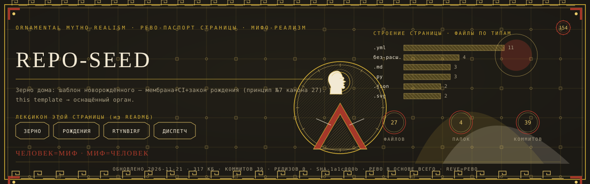

<!--ФОРЖ:ПАСПОРТ:НАЧАЛО-->
<div align="center">
  
</div>

| ФАЙЛОВ | ПАПОК | КОММИТОВ | ОБНОВЛЕНО | РЕЛИЗОВ |
|---:|---:|---:|---|---:|
| 22 | 4 | 1 | 2026-11-19 | 0 |
<!--ФОРЖ:ПАСПОРТ:КОНЕЦ-->

# repo-seed · зерно дома

Зерно района (волна ×7, 2026-11-18; принцип №7 канона 27 repo-doctrine:
«новорождённый рождается оснащённым»). Нажми **Use this template** —
и новое репо рождается с мембраной, CI и законом дома уже внутри.

**Прямое рождение по ссылке:** https://github.com/rtynbirf/repo-seed/generate

## Что несёт зерно

- `README.md` — паспорт смысла (1 смысл = 1 репо)
- `LICENSE` (MIT) · `SECURITY.md` · `AGENTS.md` — мембрана дома
- `ci.yml` — живой гейт (тесты зелёные с первого такта)
- `tests/` — храповик: тесты только добавляются

## Закон рождения (обязательный шаг)

После создания репо из зерна — объяви его дому, чтобы фасад узнавал
новорождённого по событию (принцип №3: «рождение — событие, а не расписка»):

```bash
gh api repos/rtynbirf/.github/dispatches -f event_type=repo-born
```

Фасад пересоберётся сразу (`facade-birth.yml`); недельный крон — только
страховка. Если у тебя нет ключа с правом диспетча — не важно: страховочный
крон догонит за ≤7 дней, но закон рождения — диспетч руками волны.

## Ритуал новорождённого

1. Репо из зерна → 2. паспорт смысла в README → 3. диспетч рождения →
4. первый коммит с пруфом «Поработал? Сделал? Убрал за собой».
